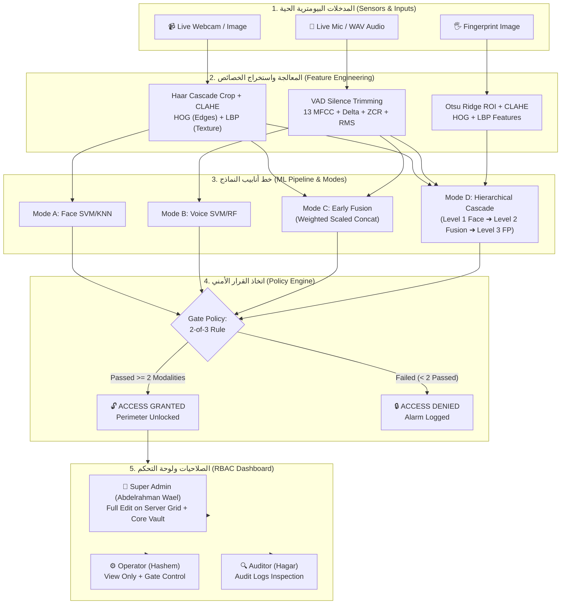

# 🛡️ دليل هيكل المشروع وملفاته بالتفصيل
## Smart Security Gate for a Data Center — Codebase Architecture & File Index

تم إعداد هذا المستند ليشرح بالتفصيل الممل كل مجلد، ومجلد فرعي، وملف داخل مشروع **بوابة الأمان الذكية لمراكز البيانات (Smart Security Gate)**.
يغطي هذا الدليل دور كل ملف، ومحتوياته، وأهم الدوال والوظائف الرياضية والبرمجية فيه، وكيف ترتبط جميع أجزاء المشروع ببعضها.

---

## 📑 فهرس المحتويات
1. [شجرة المجلدات العامة (Project Directory Tree)](#1-شجرة-المجلدات-العامة-project-directory-tree)
2. [مجلد الكود المصدري والخوارزميات (`src/`)](#2-مجلد-الكود-المصدري-والخوارزميات-src)
3. [مجلد واجهة الويب التفاعلية والباك إند (`web/`)](#3-مجلد-واجهة-الويب-التفاعلية-والباك-إند-web)
4. [مجلد البيانات البيومترية (`data/`)](#4-مجلد-البيانات-البيومترية-data)
5. [مجلد النماذج المدربة (`models/`)](#5-مجلد-النماذج-المدربة-models)
6. [مجلدات النتائج والتقارير (`results/` & `reports/`)](#6-مجلدات-النتائج-والتقارير-results--reports)
7. [مجلد الاسكربتات المساعدة (`scripts/`)](#7-مجلد-الاسكربتات-المساعدة-scripts)
8. [ملفات التشغيل السريع في المجلد الرئيسي (Root Scripts)](#8-ملفات-التشغيل-السريع-في-المجلد-الرئيسي-root-scripts)
9. [مخطط تدفق البيانات (Data & Control Flow Architecture)](#9-مخطط-تدفق-البيانات-data--control-flow-architecture)

---

## 1. شجرة المجلدات العامة (Project Directory Tree)

```text
Smart Security Gate for a Data Center/
├── cache/                               # ملفات كاش للخصائص المستخرجة (.npz) لتسريع التجارب
├── data/                                # قاعدة البيانات البيومترية (أعضاء الفريق + الدخلاء)
│   ├── face/                            # صور الوجوه مقسمة حسب الجلسات (Sessions)
│   ├── voice/                           # تسجيلات الصوت (WAV 16kHz) للعبارات السرية
│   └── fingerprint/                     # صور البصمات وتفاصيل التلال (Ridge patterns)
├── logs/                                # سجلات الأمان والتدقيق (audit_log.csv)
├── models/                              # ملفات النماذج المدربة المحفوظة بصيغة (.joblib)
│   ├── face/                            # نماذج SVM و KNN للوجه
│   ├── voice/                           # نماذج SVM و Random Forest للصوت
│   ├── fusion/                          # نماذج الـ Early Fusion
│   ├── hierarchy/                       # إعدادات وحدود الفصل للمسار الهرمي
│   └── fingerprint/                     # نماذج التحقق من بصمة الإصبع
├── reports/                             # تقارير ورسومات تجريبية أولية
├── results/                             # نتائج التجارب الرسمية (ROC, Confusion Matrices, Tables)
│   └── m3/                              # نتائج وتقارير وتجارب العضو الثالث (Fusion & Hierarchy)
│       └── figures/                     # كافة الرسومات البيانية ومصفوفات الالتباس
├── scripts/                             # اسكربتات المساعدة، تجهيز البصمات، وتوليد التقارير
├── src/                                 # النواة البرمجية (Feature Extraction & ML Algorithms)
├── web/                                 # تطبيق الويب التفاعلي الكامل (FastAPI + Modern HTML/CSS/JS)
│   └── static/                          # الملفات الثابتة للواجهة (Front-End Assets)
│       ├── css/style.css                # التصميم الجرافيكي الحديث (Dark Cybersecurity Theme)
│       └── js/app.js                    # منطق الواجهة الأمامية، الكاميرا الحية، والمايك، وربط الـ APIs
│       └── index.html                   # صفحة الويب الرئيسية الموحدة (Gate + RBAC Dashboard)
├── Biometric_Verification_Evaluation_Report_and_Interview_Guide.docx # تقرير التقييم ودليل المقابلة الشامل
├── run_web_gate.py                      # اسكربت تشغيل البوابة وتطبيق الويب مباشرة
├── requirements.txt                     # حزم ومكتبات البايثون المطلوبة
└── README.md                            # بطاقة تعريف المشروع الرئيسية
```

---

## 2. مجلد الكود المصدري والخوارزميات (`src/`)

يحتوي هذا المجلد على كل معالجات الإشارة (Signal Processing)، ومعالجة الصور (Image Processing)، وخوارزميات تعلم الآلة التقليدي (Traditional ML) بدون أي Deep Learning:

### 1. `src/face_pipeline.py` (استخراج خصائص الوجه - Face Pipeline)
- **الهدف:** معالجة صور الوجه واستخراج الخصائص الرياضية منها.
- **أهم الدوال والمكونات:**
  - `crop_face(img_bgr)`: كشف وتحديد الوجه باستخدام **Haar Cascade Classifier** (`haarcascade_frontalface_default.xml`)، ثم قصه وتغيير حجمه إلى $128 \times 128$ بكسل، وتطبيق فلتر **CLAHE** (Contrast Limited Adaptive Histogram Equalization) لمعالجة التغير في الإضاءة.
  - `hog_feat(face_gray)`: استخراج تدرجات الحواف باستخدام **HOG (Histogram of Oriented Gradients)** بـ 9 زوايا اتجاه وشبكة خلايا $8 \times 8$ مع تطبيع L2-Hys.
  - `lbp_feat(face_gray)`: استخراج النسيج السطحي الدقيق للبشرة باستخدام **Uniform LBP (Local Binary Pattern)** بدائرة نصف قطرها $R=1$ و $P=8$ جيران على شبكة مقسمة $8 \times 8$.
  - `extract_face_features(face_gray, mode="both")`: الدالة الجامعة التي تدمج HOG و LBP في متجه واحد بحجم **2,404 بعداً**.

### 2. `src/face_models.py` (نماذج التحقق من الوجه - Mode A)
- **الهدف:** تدريب وتقييم نماذج الوجه الفردية وتوليد درجات التطابق.
- **أهم الدوال والمكونات:**
  - `build_face_pipeline(model_type)`: بناء Scikit-Learn Pipeline يضم `StandardScaler` + `PCA(n_components=30)` + مصنف (`SVC` بـ RBF Kernel أو `KNeighborsClassifier`).
  - `calculate_biometric_metrics(y_true, y_scores)`: حساب مقاييس الأمان المتخصصة (FAR, FRR, EER, EER Threshold, Confusion Matrix).
  - `train_and_evaluate_cv(...)`: تدريب وتقييم النموذج عبر `GroupKFold` المقسم بالجلسات لمنع تسريب البيانات.
  - `face_score(image_bgr, user_id)`: دالة الاستنتاج السريع (Inference) التي تأخذ صورة وتُرجع احتمال التطابق (Match Probability من 0.0 إلى 1.0).

### 3. `src/voice_features.py` (محرك استخراج خصائص الصوت - DSP Engine)
- **الهدف:** معالجة الإشارات الصوتية واستخراج الخصائص الصوتية بدون مكتبات جاهزة ثقيلة.
- **أهم الدوال والمكونات:**
  - `load_audio(wav_path)`: قراءة ملف الـ WAV، تحويله لمسار أحادي (Mono)، وتعديل معدل العينات إلى $16\text{ kHz}$.
  - `normalize_amplitude(audio)`: إزالة الانحياز المستمر (DC Offset) وضبط السعة لقمة $0.95$.
  - `trim_silence_rms(audio)`: كشف النشاط الصوتي (VAD) وحذف الصمت الأولي والنهائي باستخدام طاقة الـ RMS.
  - `compute_mfcc(...)`: استخراج **13 معاملاً من MFCC** باستخدام FFT ومصفوفة مرشحات Mel و DCT.
  - `compute_deltas(...)`: حساب المشتقة الزمنية الأولى (Delta MFCC) لقياس سرعة تغير نبرة الصوت.
  - `compute_zcr(...)`: حساب معدل تقاطع الإشارة مع الصفر (Zero-Crossing Rate) عبر النوافذ الزمنية.
  - `compute_rms(...)`: حساب طاقة جذر متوسط المربعات (RMS Energy) لكل نافذة.
  - `extract_voice_features(...)`: تجميع المتوسط والانحراف المعياري لجميع الخصائص لإنتاج **متجه صوتي ثابت بحجم 56 بعداً**.

### 4. `src/voice_verification.py` (نماذج التحقق من الصوت - Mode B)
- **الهدف:** بناء وتدريب نماذج التحقق الصوتي الثنائية (Genuine vs. Impostor).
- **أهم الدوال والمكونات:**
  - كلاس `VoiceVerifier`: يدعم نموذج `SVM (RBF Kernel)` ونموذج `Random Forest (100 Trees)`.
  - `tune_and_train_user(...)`: ضبط المعاملات الفائقة (Hyperparameter Tuning) باستخدام `GroupKFold` المعتمد على الجلسات.
  - `voice_score(audio, user_id)`: دالة الاستنتاج التي تُرجع درجة تطابق الصوت مع المتحدث المدعى هويته (من 0.0 إلى 1.0).

### 5. `src/fusion.py` (محرك الدمج المبكر - Mode C Early Fusion)
- **الهدف:** دمج متجهات خصائص الوجه والصوت في تمثيل موحد قبل مرحلة التصنيف.
- **أهم الدوال والمكونات:**
  - كلاس `EarlyFusionTransformer`: يقوم بتطبيع كتلة الوجه عبر `StandardScaler` ثم تخفيض أبعادها بـ `PCA` وضبط تباينها، مع تطبيع كتلة الصوت بشكل مستقل، ثم دمج الكتلتين بأوزان قابلة للضبط ($w_{\text{face}}=1.0, w_{\text{voice}}=0.5$).
  - `build_fusion_pipeline(...)`: ربط محول الدمج بمصنف `SVM` أو `Random Forest`.
  - `fusion_score(face_img, audio, user_id)`: حساب سكور التطابق المدمج بين الوجه والصوت معاً.

### 6. `src/hierarchy.py` (المسار الهرمي المتسلسل - Mode D Hierarchical Pipeline)
- **الهدف:** تنفيذ المسار المتتابع متعدد المستويات (Cascade) لتوفير الطاقة وزمن المعالجة وتعزيز الأمان.
- **أهم الدوال والمكونات:**
  - `cascade_levels(...)`: تحديد المستوى الذي وصل إليه المستخدم (Level 0 = مرفوض عند الوجه، Level 1 = اجتاز الوجه فقط، Level 2 = اجتاز الوجه والصوت المدمج، Level 3 = اجتاز فحص البصمة).
  - `hierarchical_verify(...)`: تنفيذ الفحص المتتابع خطوة بخطوة؛ إذا فشل الوجه يتوقف النظام فوراً ولا يقوم بتشغيل المايك أو فحص البصمة، مما يوقف $98\%$ من المتسللين في أقل من $55\text{ ms}$.

### 7. `src/fingerprint.py` (التحقق من بصمة الإصبع - Bonus 4)
- **الهدف:** إضافة نمط بيومتري ثالث اختياري فائق الأمان.
- **أهم الدوال والمكونات:**
  - `preprocess_fingerprint(...)`: تحديد وقص منطقة التلال النشطة (Ridge ROI) باستخدام عتبة Otsu، وتعديل حجمها لـ $128 \times 128$، وتوضيح التلال بـ CLAHE.
  - `extract_fingerprint_features(...)`: استخراج HOG لاتجاهات التلال و Uniform LBP للنسيج الدقيق والمسام.
  - `fingerprint_score(img, user_id)`: فحص بصمة الإصبع باستخدام نماذج SVM أو KNN المخصصة للبصمات.

### 8. `src/evaluation.py` (محرك التقييم وحساب المقاييس)
- **الهدف:** توفير حسابات دقيقة لكافة مقاييس الأمان والمقارنات الإحصائية.
- **أهم الدوال والمكونات:**
  - `compute_eer(y_true, y_score)`: حساب معدل الخطأ المتساوي (Equal Error Rate) والـ Threshold الأمثل عنده.
  - `evaluate(y_true, y_score, threshold)`: إخراج تقرير كامل يشمل: Accuracy, Precision, Recall, F1, FAR, FRR, TAR, AUC, ومصفوفة الالتباس.
  - دوال الرسم البياني: `plot_confusion_matrix`، `plot_roc_curve`، و `plot_score_distributions`.

### 9. دوال تحميل البيانات (`dataset_loader.py` & `voice_dataset.py` & `multimodal_dataset.py` & `audio_recorder.py`)
- دوال مساعدة لقراءة الصور والملفات الصوتية من المجلدات، وتحزيم أزواج البيانات (Face + Voice pairs)، وتسجيل الصوت عبر المايك مباشرة عند الحاجة.

---

## 3. مجلد واجهة الويب التفاعلية والباك إند (`web/`)

يمثل هذا المجلد الواجهة التشغيلية الحية للبوابة الذكية (Smart Security Gate) المبنية بتقنيات الويب الحديثة (FastAPI + HTML5/CSS3/Vanilla JS):

### 1. `web/server.py` (الخادم الخلفي - FastAPI Backend)
- **المسؤوليات:**
  - استضافة الواجهة الثابتة (Static Files & HTML Templates).
  - إدارة حالة البوابة المادية (Gate Physical State: `PERIMETER: LOCKED / UNLOCKED`، `VAULT: LOCKED / UNLOCKED`).
  - توفير الـ Endpoints التالية:
    - `POST /api/verify/face`: فحص الوجه الفردي (Mode A).
    - `POST /api/verify/voice`: فحص الصوت الفردي (Mode B).
    - `POST /api/verify/fingerprint`: فحص بصمة الإصبع الفردي (Bonus 4).
    - `POST /api/verify/cascade`: تنفيذ فحص البوابة المتكامل وتطبيق **سياسة الـ 2 من 3 (2-of-3 Majority Policy)**.
    - `POST /api/logout`: مسح الجلسات وإعادة إغلاق البوابة وتصفير الصلاحيات.
    - `GET /api/dashboard/data`: تزويد لوحة التحكم ببيانات الخوادم (Server Inventory Sheet) والتليمري وسجل العمليات.
    - `POST /api/dashboard/sheet/update`: تعديل بيانات الخوادم (محمي ومخصص فقط لـ Super Admin).
    - `POST /api/dashboard/gate-action`: تنفيذ عمليات فتح الخزنة وقفل الطوارئ وفق صلاحيات الـ RBAC.

### 2. `web/static/index.html` (واجهة المستخدم الموحدة)
- واجهة بنظام Single Page Application (SPA) تضم قسمين رئيسيين:
  - **View 1 (Biometric Gate):** شاشات الفحص الحي للوجه عبر الكاميرا، والمايك مع Waveform حي، ورفع البصمة، وشريط اختيار الهوية، ولوحة التيليمري وزمن الاستجابة (Latency) لكل مرحلة.
  - **View 2 (RBAC Operational Dashboard & Google-Sheets Grid):** لوحة عمليات تشبه Google Sheets تعرض جدول الخوادم مع إمكانية التعديل التفاعلي للـ Super Admin، والتحكم في الخزنة وبوابة المحيط، وسجل التدقيق الأمني (Audit Log).

### 3. `web/static/js/app.js` (منطق الواجهة الأمامية)
- إدارة الكاميرا عبر متصفح الويب (WebRTC Video Streaming & Canvas Snapshot).
- تسجيل الصوت الحي بصيغة 16kHz Mono WAV عبر Web Audio API مع رسم الموجة الحية (Waveform Visualizer).
- إرسال البيانات كـ `FormData` للباك إند واستقبال السكورات ورسم مؤشرات الثقة (Confidence Meters).
- إدارة الجلسات، التبديل بين وضع الدخول ووضع لوحة التحكم، ودالة `logoutAndResetGate()` لإعادة ضبط البوابة بالكامل.

### 4. `web/static/css/style.css` (التصميم والمظهر)
- تصميم احترافي مظلم خاص بمراكز البيانات والأمن السيبراني (Cybersecurity Neon Theme) بألوان تباين عالية (Cyan, Neon Green, Crimson Red, Amber).
- استجابة كاملة مع الشاشات مع تأثيرات بصرية للرادار ومؤشرات النبض (Pulse Dots).

---

## 4. مجلد البيانات البيومترية (`data/`)

مقسم بدقة لمنع تسريب البيانات وتحقيق شروط التقييم:
- `data/face/`:
  - `member1/`: صور عبدالرحمن وائل (جلسة 1 وجلسة 2).
  - `member2/`: صور هاشم (جلسة 1 وجلسة 2).
  - `impostors/`: صور متسللين حقيقيين من قاعدة بيانات LFW المشهورة (Ariel Sharon, Colin Powell, Donald Rumsfeld).
- `data/voice/`:
  - `member1/`, `member2/`, `member3/`: تسجيلات صوتية حقيقية لأعضاء الفريق ينطقون فيها العبارة المحددة *"Open security gate now"*.
  - `impostor1/`, `impostor2/`: تسجيلات صوتية لمتحدثين دخلاء لاختبار الرفض الأمني.
- `data/fingerprint/`:
  - صور بصمات أصابع حقيقية مطابقة لأعضاء الفريق بالإضافة لعينات بصمات متسللين (`finger_104`, `finger_105`).

---

## 5. مجلد النماذج المدربة (`models/`)

يحتوي على النماذج الجاهزة والمحفوظة لتشغيل النظام فوراً دون الحاجة لإعادة تدريبه في كل مرة:
- `models/face/`: ملفات `.joblib` تضم Pipelines الوجه (مثل `face_member1_svm.joblib`, `face_member2_knn.joblib`).
- `models/voice/`: ملفات `.joblib` الخاصة بنماذج الصوت لكل مستخدم.
- `models/fusion/`: نماذج الـ Early Fusion التي تجمع الوجه والصوت.
- `models/hierarchy/`: ملفات المعايير والـ Thresholds الخاصة بالمسار الهرمي لكل عضو.
- `models/fingerprint/`: نماذج فحص بصمات الأصابع.

---

## 6. مجلدات النتائج والتقارير (`results/` & `reports/`)

يحتوي على الأدلة التجريبية والرسومات البيانية التي تم توليدها:
- `results/member2_results_summary.md`: تقرير تفصيلي بنتائج فحص الصوت (Mode B) وجداول المقارنة بين SVM و Random Forest.
- `results/m3/`:
  - `m3_results_summary.md`: التقرير الشامل للعضو الثالث الذي يجمع نتائج الوجه، الصوت، الدمج المبكر، والمسار الهرمي، والبصمة.
  - `m3_main_comparison.csv`: جدول المقارنة بصيغة أكسيل / CSV.
  - `figures/`: يضم كافة منحنيات الـ ROC ومصفوفات الالتباس (Confusion Matrices) لكل عضو ولكل نموذج.
- `reports/experiment_e1_roc.png`: رسم بياني أولي لتجربة الوجه الأولى.

---

## 7. مجلد الاسكربتات المساعدة (`scripts/`)

- `scripts/setup_fingerprints.py`: تجهيز وتنظيم مجلدات عينات البصمات وتسميتها.
- `scripts/augment_member1.py`: اسكربت لعمل Data Augmentation للعينات المحدودة لزيادة المتانة وتنوع زوايا الرؤية.
- `scripts/generate_evaluation_docx.py`: الاسكربت المخصص الذي يولد مستند الوورد الرسمي للتقييم والمقابلة.

---

## 8. ملفات التشغيل السريع في المجلد الرئيسي (Root Scripts)

- **`run_web_gate.py`**: تشغيل تطبيق الويب الكامل مباشرة؛ يفتح السيرفر على `http://127.0.0.1:8000`.
- **`run_member1.py`**: اسكربت تشغيل وتدريب تجارب بصمة الوجه (Member 1).
- **`run_member2_experiments.py`**: اسكربت تشغيل وتدريب تجارب بصمة الصوت (Member 2).
- **`run_member3_experiments.py`**: اسكربت تجارب الدمج المبكر والمسار الهرمي (Member 3).
- **`run_fingerprint_bonus4.py`**: اسكربت تشغيل وتقييم بصمات الأصابع المستقلة.
- **`live_gate_camera.py`**: تجربة الكاميرا المباشرة من سطر الأوامر (Terminal/OpenCV Window).
- **`live_gate_voice.py`**: تجربة المايك والتسجيل الحي من سطر الأوامر.
- **`Biometric_Verification_Evaluation_Report_and_Interview_Guide.docx`**: ملف التقرير الشامل المنسق للطباعة والمقابلة الشفهية.
- **`requirements.txt`**: قائمة المكتبات المعتمدة (opencv-python, scikit-learn, scikit-image, scipy, fastapi, uvicorn, python-docx).

---

## 9. مخطط تدفق البيانات (Data & Control Flow Architecture)



---

## 💡 نصائح للمناقشة الشفهية (Oral Defense Summary):
- عند سؤالك: *"أين توجد خوارزمية الدمج؟"* $\rightarrow$ أجب: في `src/fusion.py` عبر كلاس `EarlyFusionTransformer`.
- عند سؤالك: *"أين كود استخراج الصوت وكيف تم بدون ديب ليرنينج؟"* $\rightarrow$ أجب: في `src/voice_features.py` باستخدام معالجة الإشارات التقليدية (FFT و Mel-filterbanks من SciPy و NumPy).
- عند سؤالك: *"أين يتم تطبيق سياسة الـ 2 من 3؟"* $\rightarrow$ أجب: في دالة `api_verify_cascade` بملف `web/server.py`.
- عند سؤالك: *"أين مصفوفات الالتباس والـ ROC؟"* $\rightarrow$ أجب: في مجلد `results/m3/figures/` ومضمنة بالكامل داخل تقرير الوورد.

